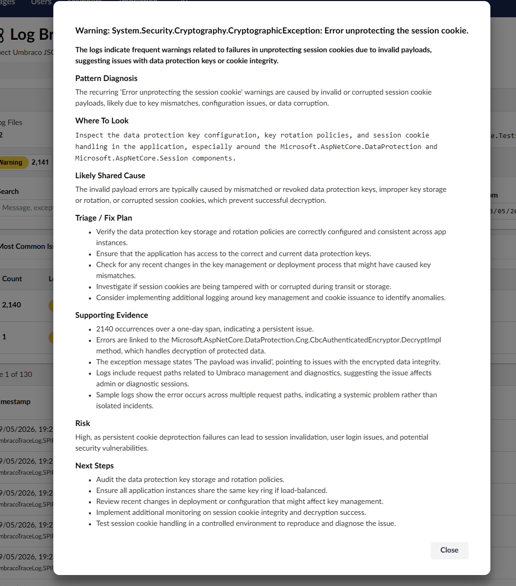
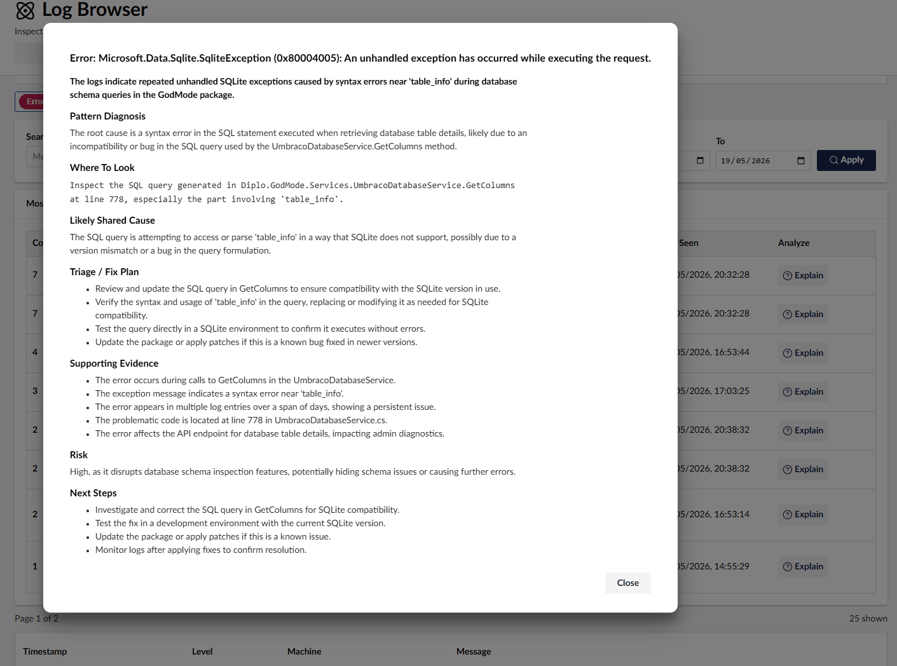
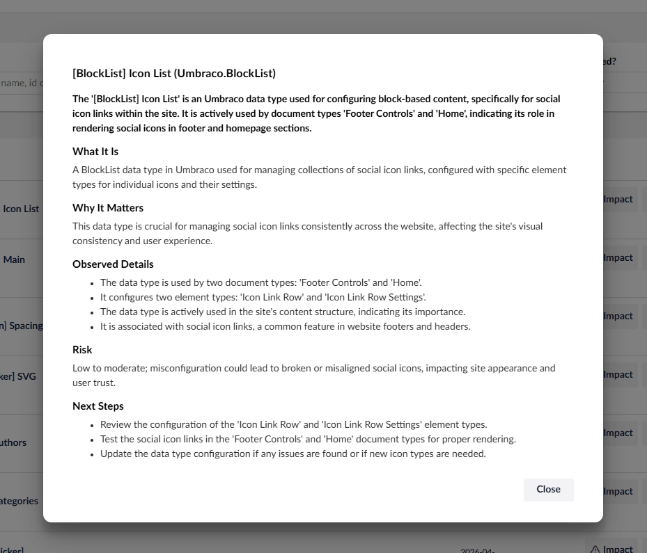

# Diplo God Mode AI

Diplo God Mode AI is the optional [Umbraco.AI](https://docs.umbraco.com/ai-in-umbraco) companion package for **[Diplo God Mode](https://www.nuget.org/packages/Diplo.GodMode)**.

It adds contextual **Explain** buttons to supported God Mode views, helping developers understand diagnostics, service registrations, log patterns, content metadata, data types, templates, partials, tags, and other implementation details from inside the Umbraco 17 or 18 backoffice.

## Requirements

Both release lines require **.NET 10**. Install the version for your CMS major:

| AI package | CMS | God Mode core | Umbraco.AI |
| --- | --- | --- | --- |
| 17.0.0 | [17.3.0,18.0.0) | [17.5.0,18.0.0) | [1.10.1,2.0.0) |
| 18.0.0 | [18.2.0,19.0.0) | [18.5.0,19.0.0) | [18.3.5,19.0.0) |

## Release notes: 17.0.0 / 18.0.0

* Adds **Explain scheduling health** with lazy, bounded evidence, complete counts
  and guidance that distinguishes incomplete checks and historical registrations
  from outages. It cannot change settings or delete data.
* Adds a separate Umbraco 18.2+ build from shared source.
* Versions now align with the CMS major. The jump from `1.0.0` to `17.0.0` is
  intentional; it does not require a CMS upgrade away from v17.
* Update core and AI together for the complete new feature. Earlier AI `1.0.0`
  remains published; existing Explain behaviour with new v17 core is expected to
  work but that mixed-version combination has not been runtime tested.
* Updates structured-response budget and cloned-provider authentication guidance.

For Umbraco 17:

```powershell
dotnet add package Diplo.GodMode --version 17.5.0
dotnet add package Diplo.GodMode.AI --version 17.0.0
```

For Umbraco 18.2+, use core `18.5.0` and AI `18.0.0`. Configure an AI provider
package compatible with your Umbraco.AI major; it is not bundled by God Mode AI.

## Umbraco.AI Setup

God Mode AI uses your [Umbraco.AI](https://docs.umbraco.com/ai-in-umbraco) configuration. Before using the **Explain** buttons, make sure Umbraco.AI has a working provider connection and profile:

1. Install [Umbraco.AI](https://marketplace.umbraco.com/package/umbraco.ai) in the Umbraco site.
2. Install an AI provider package, such as the OpenAI provider.
3. In the Umbraco backoffice, create a connection for your provider.
4. Create an AI profile that uses that connection.
5. Select the model you want the profile to use, for example `gpt-4.1-nano` for OpenAI.
6. Restart the site and open God Mode in the backoffice.

## Configuration

Scheduled Publishing includes an on-demand **Explain scheduling health** action.
It combines the workspace's schedule, publishing-job and server-registration
evidence into an overall assessment and suggested checks. It uses bounded samples
with complete counts, reports unknown evidence, and does not treat a recent job
timestamp as proof of successful publishing. It cannot execute fixes or cleanup.

Settings are optional and read from the `Diplo:GodMode:AI` section of `appsettings.json`:

```json
{
  "Diplo": {
    "GodMode": {
      "AI": {
        "ChatProfileAlias": "my-profile-alias",
        "MaxOutputTokens": 4096
      }
    }
  }
}
```

* `ChatProfileAlias` is the alias of the Umbraco.AI profile used for explanations. When it is not set, Umbraco.AI selects the profile using its own defaults.
* `MaxOutputTokens` and `Temperature` override the profile's chat options for God Mode explanations only.

God Mode requests a structured JSON explanation. A small output budget can cut
off the response and cause an incomplete JSON error. Start with an allowance such
as `4096`, then adjust for the selected model and the size of the explanation.
This allowance completed an explanation in local testing; it is not a guaranteed
minimum for every model. Reasoning models may use part of the allowance before
producing visible output. Higher limits can increase latency and cost.

Leave `Temperature` unset unless the selected model supports that option. After
cloning or upgrading a site, an authentication failure may require re-entering
the provider connection's credentials; changing the token allowance will not fix
authentication errors.

Useful Umbraco.AI docs:

* Getting started: https://docs.umbraco.com/ai-in-umbraco/getting-started/getting-started
* Installation: https://docs.umbraco.com/ai-in-umbraco/getting-started/installation
* First connection: https://docs.umbraco.com/ai-in-umbraco/getting-started/first-connection
* First profile: https://docs.umbraco.com/ai-in-umbraco/getting-started/first-profile

## Screenshots









## Links

* God Mode NuGet: https://www.nuget.org/packages/Diplo.GodMode
* God Mode AI NuGet: https://www.nuget.org/packages/Diplo.GodMode.AI
* GitHub: https://github.com/DanDiplo/Umbraco.GodMode
* Umbraco Marketplace: https://marketplace.umbraco.com/package/diplo.godmode
